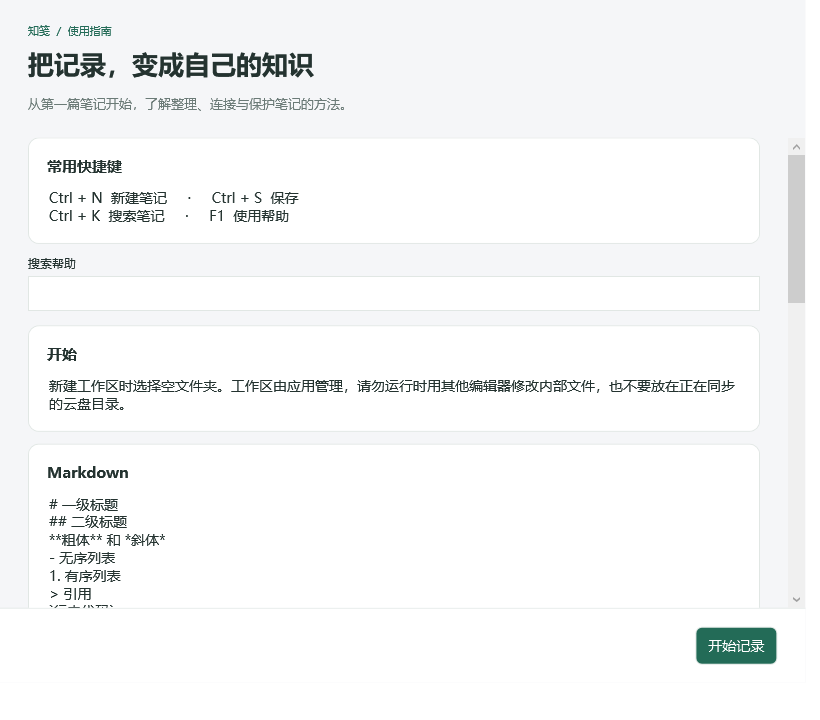
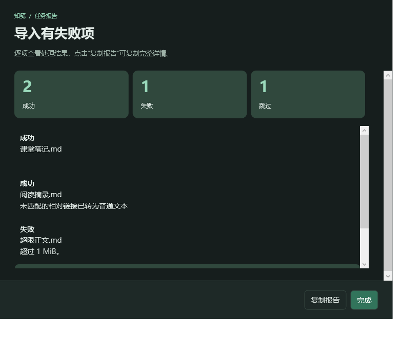

# 更改记录

## 2026-10-27 — 弹窗界面升级

### 界面与交互
- 帮助改为分组卡片式指南，增加关键词搜索与快捷键速览。
- 导入、导出、永久删除结果使用结构化报告，分别展示成功、失败、跳过数量，并提供完整报告复制按钮。
- 含警告、失败或取消的报告使用对应标题，避免将部分失败误显示为全部成功。
- 永久删除确认列出受影响笔记，使用红色操作按钮，并默认聚焦取消；保留原有数据删除逻辑。
- 统一备份结果、错误提示、工作区检查、外部链接确认、双链选择器、未保存关闭提示的卡片布局与底部操作区。
- 弹窗支持浅色/深色主题、内容滚动与窗口调整；长批次报告采用列表虚拟化。

### 验证
- Release 构建：0警告、0错误。
- 核心检查：38/38通过。
- 主界面回归：12项通过，绑定日志为空。
- 弹窗专项：8项通过，覆盖两种主题的帮助/混合结果报告/删除取消，以及确认返回值和继续编辑。
- 已查看帮助浅色、报告深色、删除浅色的渲染截图；未进行所有DPI比例下的人工验收。
- 弹窗检查不操作真实工作区，不执行实际删除。执行方式：程序 --dialog-check 输出目录。

### 预览

