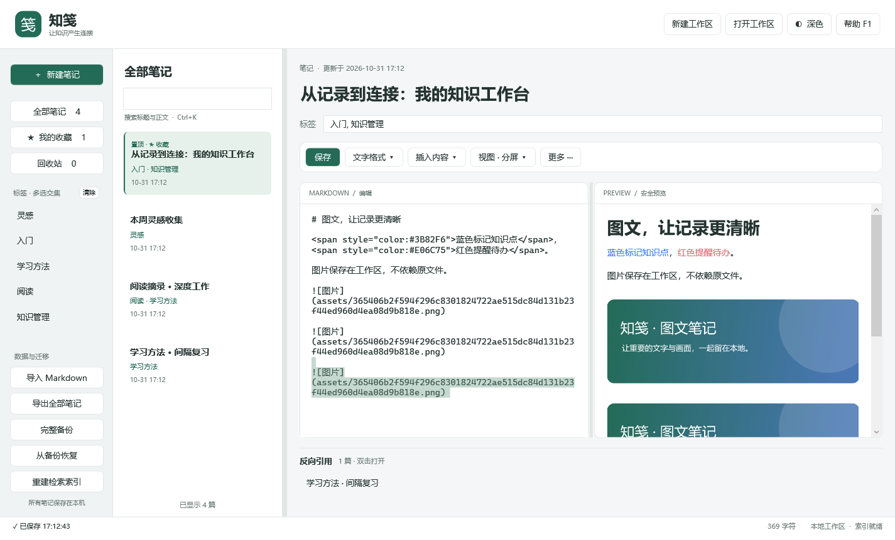
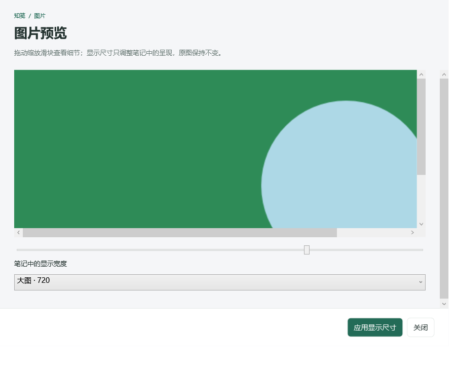
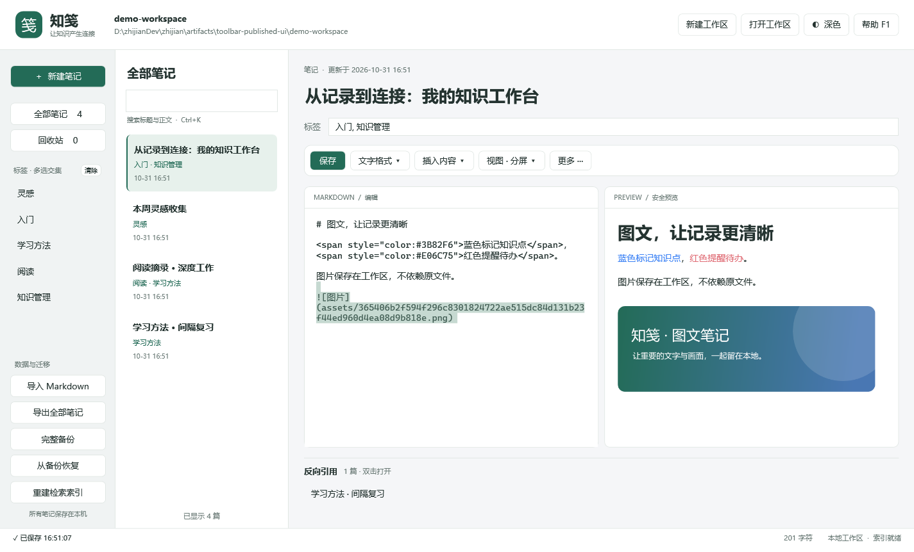
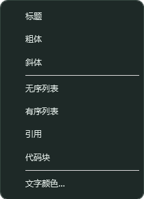
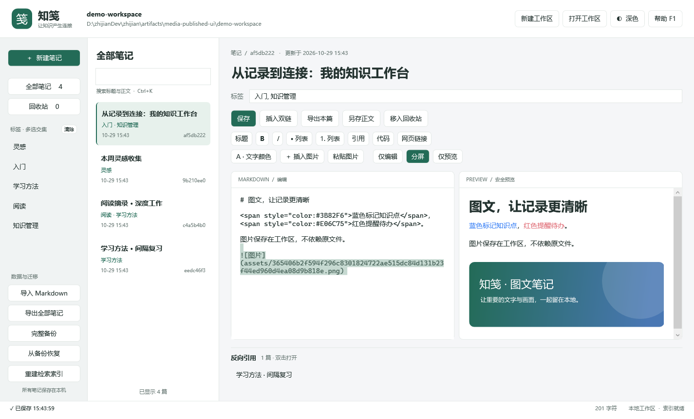
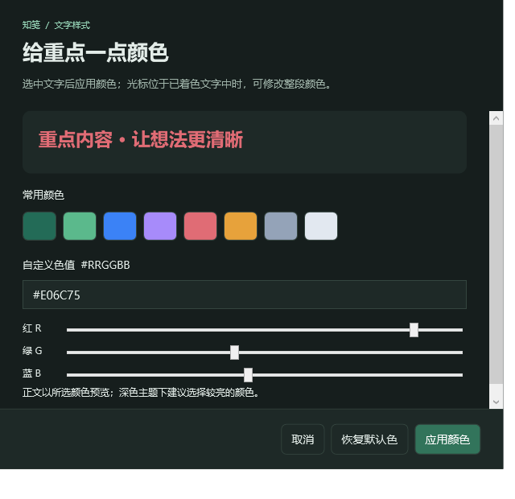
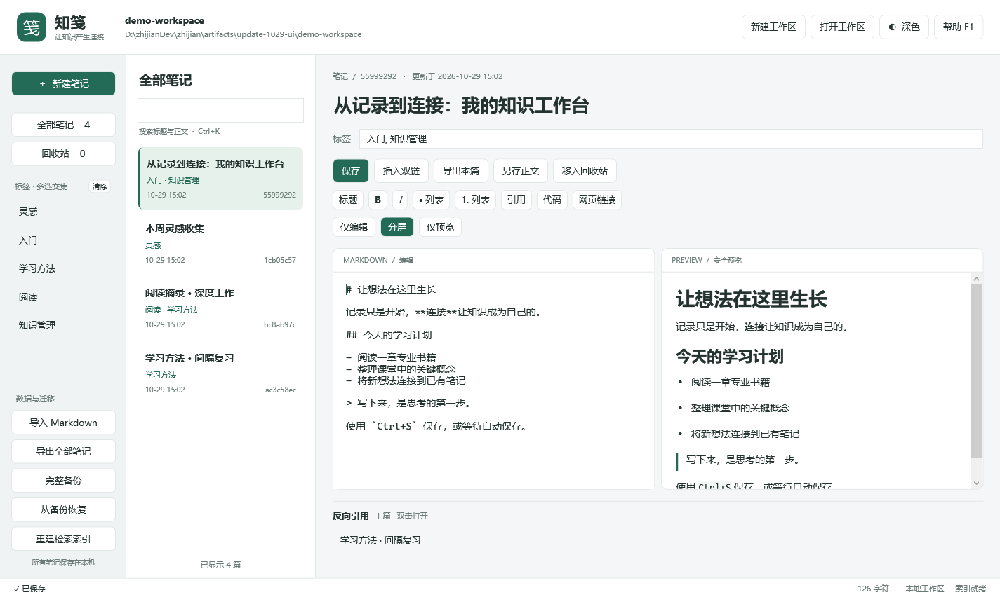
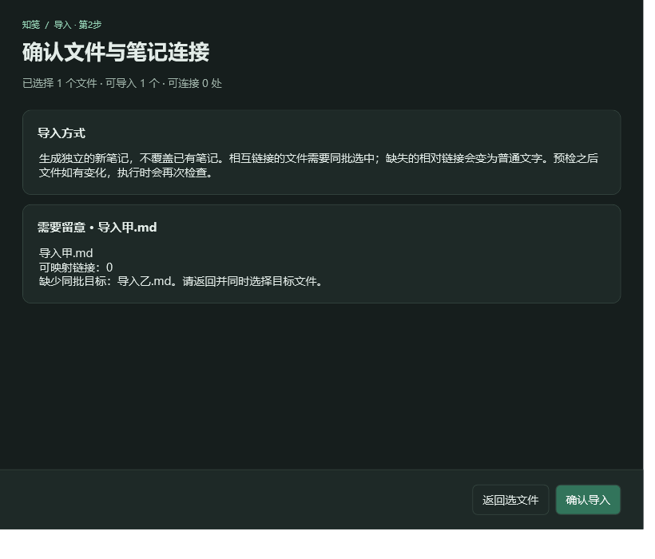
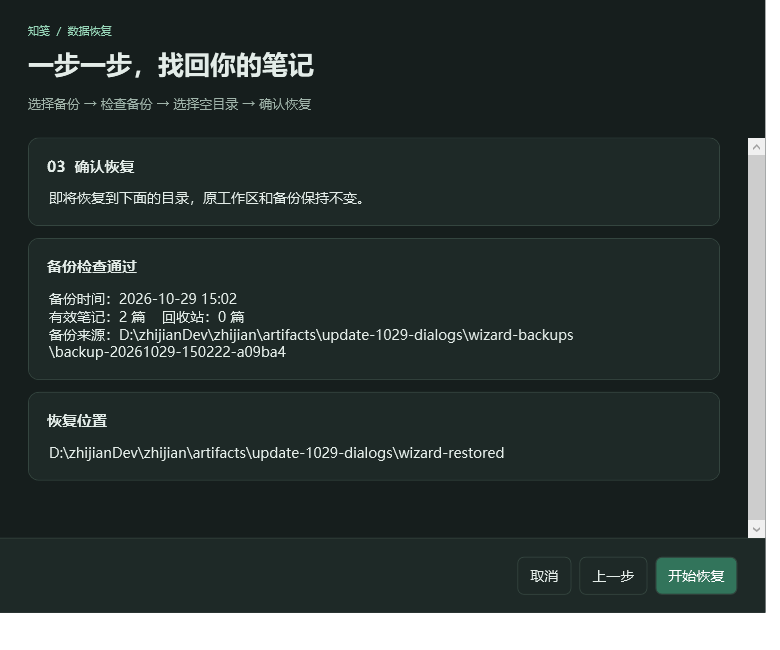

# 更改记录

## 2026-10-31 — 1.3.0 图片交互、置顶收藏与可调分栏

- 图片可拖入正文、Ctrl+V粘贴位图或图片文件；点击预览进入查看窗口，支持缩放及调整显示宽度，保留原附件和Markdown图片说明文字。
- 新增置顶/收藏菜单和“我的收藏”入口；置顶排序适用于搜索与分页，标记持久化并随完整备份保留，回收站恢复保留标记。
- 列表与编辑预览支持拖动分隔条，宽度和比例随工作区保存，切换视图及重启恢复；主题切换不覆盖布局配置。
- 更新离线帮助及手工验收清单，版本提升到1.3.0。新版本可读旧数据；新字段需使用1.3及以上版本打开和恢复。
- 修正UI测试等待虚拟化列表容器生成的时机，避免容器未就绪引起误报。

验证：Release发布成功；47项核心检查、59项发布版界面检查、15项弹窗与恢复向导检查通过；绑定日志为空。查看了浅色主界面、1100×700深色布局和图片查看窗口截图。真实操作系统剪贴板未被测试覆盖或修改，跨应用拖放可按手工清单复核。

## 2026-10-31 — 简化工作区页眉

- 移除顶部工作区名称与本地磁盘路径，保留工作区操作与原有数据。
- 验证：Release 构建零警告零错误，45 项界面检查通过，绑定日志为空。

## 2026-10-31 — 1.2.1 清爽的笔记操作栏

- 笔记头部与列表隐藏内部编号，新增“更多 → 笔记信息”供需要时查看完整编号和创建/更新时间；内部ID不变，双链不受影响。
- 多行按钮收拢为保存、文字格式、插入内容、视图、更多五个入口，原有功能全部保留。
- 菜单按用途分组，支持浅色/深色主题，视图菜单标示当前模式；为正文释放更多垂直空间。
- 回收站内禁用文字与插入操作，“更多”菜单切换为恢复/永久删除，并禁用不支持的导出本篇。
- 保存后同步刷新头部更新时间，更新离线帮助和README入口说明。

验证：Release构建0警告0错误；发布版主界面45项、弹窗/向导12项检查通过（包含21项菜单入口保留、左键展开、选区加粗、三种视图选中状态、回收站菜单状态和两种主题）；绑定日志为空。已查看正常尺寸和1100×700紧凑窗口截图。全部DPI和纯键盘导航仍需人工验收。

## 2026-10-29 — 1.2.0 文字颜色与本地图片

### 新增
- 文字颜色选择器：预设色、HEX输入、RGB滑块、即时示例、恢复默认色，支持修改已有颜色和撤销。
- 插入PNG/JPEG和粘贴剪贴板图片，工作区托管附件并按内容去重；预览自适应宽度，原图移动不影响显示。
- 图片随正文导出/另存、重新导入以及完整备份恢复。含图片备份使用格式2，继续兼容旧纯文字备份。
- 导入预检新增图片缺失、超限、远程与越界路径提示。预览只读取工作区托管图片，并校验摘要，不执行脚本或下载远程图片。
- 整合媒体操作与布局按钮，适配浅色/深色主题，更新离线帮助。

### 验证
- 核心44/44通过：覆盖图片去重、导出/导入、回收站图片备份恢复、篡改校验、路径限制及代码块忽略。
- 主界面35项通过：覆盖文字换色、重新换色、清除颜色、撤销、图片持久保存与原图移动后显示；绑定日志为空。
- 弹窗与向导12项通过，包括颜色输入校验和返回值。
- 已查看浅色图文预览、深色颜色选择器和紧凑窗口；系统剪贴板实际粘贴、多显示器及全部DPI组合尚需人工验收。

### 使用边界
- 支持PNG/JPEG，单图10 MiB、最长边8192像素、总像素2400万以内；不含SVG、GIF动画、远程图片下载。
- 颜色在预览区显示，编辑区仍是Markdown源码；第三方查看器的颜色支持取决于其HTML设置。
- 删除图片引用不立即清理共享附件，新备份仅收集有效笔记和回收站仍引用的图片。

### 预览

## 2026-10-29 — 1.1.0 编辑与数据迁移体验更新

### 新增与优化
- Markdown工具栏：标题、粗体、斜体、无序/有序列表、引用、代码块、网页链接；支持选区和占位内容，单次撤销，回收站禁止修改。
- 仅编辑、分屏、仅预览三种布局；选中模式高亮，两侧按模式展开。
- 导入前检查文件编码、大小、标题和批内链接，逐文件展示问题，可返回补选目标后再确认。
- 修复超限或标题不合法的导入文件可能中断整批处理的问题，改为逐项失败报告。
- 创建完整备份前确认笔记数量和保存位置。
- 恢复向导展示备份时间与笔记数量，提前拒绝无效来源、包含关系或非空目标；支持返回修改、取消校验和恢复完成提示。
- 更新离线帮助和README；版本号更新为1.1.0。

### 验证
- Release构建：0警告、0错误。
- 核心检查41/41通过，包括中文链接预检与真实导入、编码/超限混合批次、UUID映射。
- 主界面25项通过，包括工具栏选区、单次撤销、多行列表、三种布局和回收站只读；绑定日志为空。
- 弹窗/向导11项通过，包括无效路径修正、上一步、确认计划及临时工作区实际恢复后的正文/双链核对。
- 已检查浅色主界面、紧凑深色主界面、导入预检和恢复确认截图。尚未覆盖所有系统DPI组合。

### 界面预览

## 2026-10-27 — 弹窗界面升级

### 界面与交互
- 帮助改为分组卡片式指南，增加关键词搜索与快捷键速览。
- 导入、导出、永久删除结果使用结构化报告，分别展示成功、失败、跳过数量，并提供完整报告复制按钮。
- 含警告、失败或取消的报告使用对应标题，避免将部分失败误显示为全部成功。
- 永久删除确认列出受影响笔记，使用红色操作按钮，并默认聚焦取消；保留原有数据删除逻辑。
- 统一备份结果、错误提示、工作区检查、外部链接确认、双链选择器、未保存关闭提示的卡片布局与底部操作区。
- 弹窗支持浅色/深色主题、内容滚动与窗口调整；长批次报告采用列表虚拟化。

### 验证
- Release 构建：0警告、0错误。
- 核心检查：38/38通过。
- 主界面回归：12项通过，绑定日志为空。
- 弹窗专项：8项通过，覆盖两种主题的帮助/混合结果报告/删除取消，以及确认返回值和继续编辑。
- 已查看帮助浅色、报告深色、删除浅色的渲染截图；未进行所有DPI比例下的人工验收。
- 弹窗检查不操作真实工作区，不执行实际删除。执行方式：程序 --dialog-check 输出目录。

### 预览

